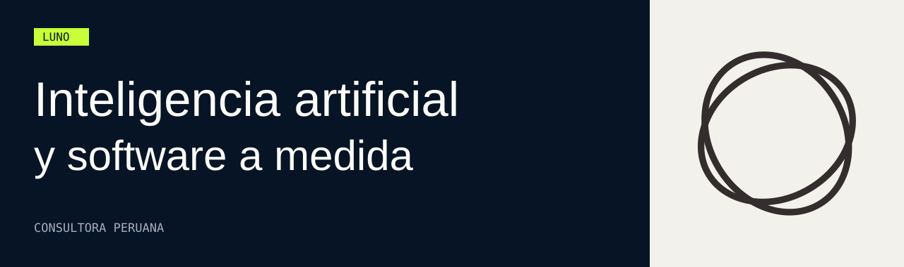

# Luno

Potenciamos equipos mediante inteligencia artificial, automatización y software a medida.

Somos una consultora peruana que trabaja con empresas de cualquier país. Diseñamos e implementamos soluciones para operaciones, ventas y procesos internos, y acompañamos su puesta en producción.

## Qué hacemos

- **Automatización con LLM:** soluciones adaptadas al trabajo de cada equipo.
- **Migración de datos:** preparación y traslado de información entre sistemas.
- **Software a medida:** herramientas construidas para procesos y necesidades concretos.

## Cómo trabajamos

Partimos de un problema operativo concreto. Definimos el alcance, construimos la solución y la validamos con el equipo que la utilizará. Explicamos las capacidades técnicas con claridad y respaldamos las propuestas con evidencia.

## Conversemos

[Agenda un diagnóstico de 45 minutos](https://calendly.com/luno-consulting/45-min-to-solve-problem) · [Visita nuestro sitio](https://lunoservices.com/)
